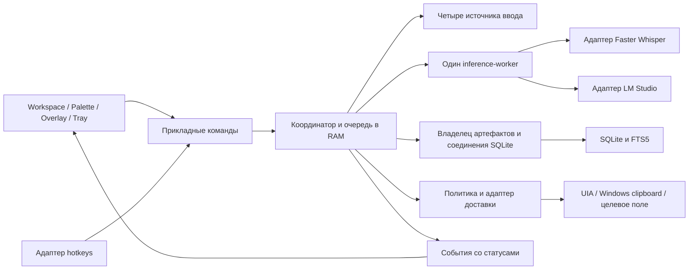
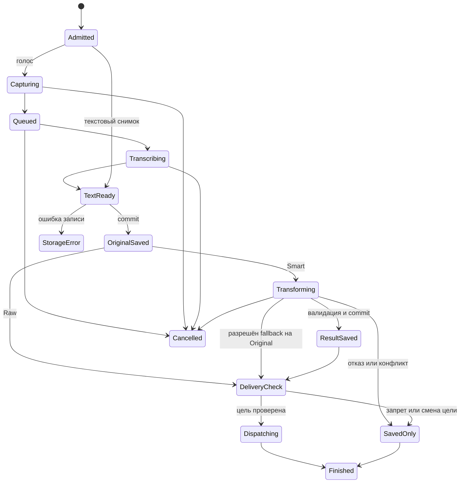

# Архитектура и жизненный цикл диктовки

## Реализация M1a · принято

Горячая клавиша резервирует одну задачу до открытия микрофона. `AudioRecorder` принимает mono float32 в ограниченный буфер. `DictationApp` связывает захват, один последовательный обработчик, сигналы Qt и существующие адаптеры Whisper и LM Studio. `Coordinator` в `src/dictation.py` фиксирует режим и модель при допуске, владеет текущей попыткой и упорядочивает отмену, публикацию и запись.

| Переход | Что можно наблюдать |
|---|---|
| Открытие микрофона → STT | Минимальная запись задачи получает `capturing`, затем `transcribing`. Короткий или переполненный ввод отбрасывается целиком. Второй PTT получает Busy. |
| STT → Original | Одна транзакция создаёт артефакт, привязывает задачу и отмечает сохранение. Raw завершён. Для Smart фиксируется `transforming` и только после commit вызывается локальная LLM. |
| Smart → результат | Вторая транзакция записывает текущий текст и статусы. При fallback в истории доступен Original. Если запись результата отказала, Original остаётся на диске, кандидат доступен в RAM. |
| Отказ записи Original | Smart пропускается. Координатор удерживает текст в RAM до выхода. Его можно вновь выбрать и скопировать после следующей диктовки. |
| Отмена и Quit | Блокировка упорядочивает отмену относительно уже начатого commit. Поздний ответ теряет право на публикацию и запись. Слот освобождается после возврата backend. Quit закрывает допуск, снимает hook, закрывает захват, ждёт inference до одной секунды и закрывает SQLite после принятых операций. |
| Перезапуск | Открытые `capturing/transcribing/transforming` получают `interrupted`; начатая доставка без подтверждения — `unknown`. Восстановление обходится без вызова LLM и без доставки. |

`HistoryStore` в `src/history.py` открывает единственное соединение в выделенном потоке, выполняет короткие транзакции и закрывает соединение в том же потоке. Схема v1 (`PRAGMA user_version`) содержит `artifacts`, `results`, `jobs`, `preferences` и `legacy_imports`. Триггер защищает Original и legacy-текст. В задаче независимо записаны обработка, достигнутый уровень сохранения и доставка. Технический код последней ошибки позволяет отличить сохранённый Original от неудачной записи результата. PCM и промпты в БД отсутствуют.

Штатная БД — `%LOCALAPPDATA%/LocalAIInputWorkspace/artifacts.sqlite3`. Новый файл использует rollback journal, `synchronous=FULL`, внешние ключи и ожидание блокировки до 0,5 с. Запускатель удерживает блокировку экземпляра. Для отдельной пробы `--profile-dir` размещает БД, технический журнал и источники legacy в выбранном каталоге.

Каждый источник JSON импортируется из одного снимка байтов в отдельной транзакции с SHA-256 и счётчиками. Идентичность legacy-строки задают снимок и позиция. Равные тексты и ID сохраняют кратность, неизвестная дата остаётся NULL. Для legacy виден известный текст с отметкой «Original unknown». Повтор того же снимка пропускается; изменившийся источник требует отдельного разбора. Из state импортируются только валидные `lm_model`, `lm_studio`, `audio_device`. Автозапуск читается из Windows. Старые файлы сохраняются.

Qt получает завершённый исход. Карточки истории читаются по 50 через курсор, кнопка Older entries открывает следующие. У отличающегося результата Smart есть Open Original. Удаление карточки помечает запись скрытой. Ручной Copy работает и для редактируемого текста. FTS, управление корзиной и retention запланированы в M4.

## Корректура M1c

Выбор Smart и идентификатор модели фиксируются при нажатии PTT. Проверка готовности модели сохраняет выбор пользователя. Координатор читает Original по ID активной задачи после commit. Если чтение отказало, HTTP пропускается. Адаптер LM Studio возвращает проверенный текст либо технический код причины. Время окончания сверяется с настроенным тайм-аутом. При отмене право записать ответ и инициировать доставку теряется.

Одна транзакция записывает строку результата и переводит задачу из `transforming/original` в `ready/result`. Завершение с ошибкой тоже условное. Закрытая задача защищена от поздней смены статуса, скрытый Original исключён из публикации. При отказе commit кандидата обработка может быть `ready`, хранение остаётся `original`, а `result_write_failed` объясняет, почему корректуру можно скопировать только из RAM. Для fallback карточка хранит причину и Original. У Auto Paste доставка доступна только после успешного сохранения выбранной версии. Для новых записей Artifact Only имеет статус `not_requested`, пропуск запрошенной вставки — `skipped`. Старые записи схемы v1 читаются с исходными статусами.

## Доставка M1b

`DictationApp` фиксирует выбранный режим при нажатии PTT. В Artifact Only обработка обходится без опроса Windows. Для Auto Paste модуль `win_target.py` проверяет профиль и время создания процесса, PID, потоки окна и поля, foreground HWND, HWND поля, класс, доступность, признаки пароля и смещения выделения. У пакетного Блокнота поле RichEditD2DPT может работать в отдельном UI-потоке того же процесса. В таком случае оба потока должны сообщить одно активное окно и одно поле в фокусе. Снимок содержит оба TID и номер изменения буфера. Содержимое буфера для доставки не требуется.

`delivery.py` запускает один ограниченный по времени вспомогательный процесс для подходящей цели. Через анонимные каналы он получает снимок, а после commit — текст. В `delivery_worker.py` подписки WinEvent отмечают смену фокуса, уничтожение поля, изменения выделения и значения. В том же COM apartment `rich_edit.py` удерживает дубликат ITextRange, полученного через OBJID_NATIVEOM у конкретного HWND. Проверяются текущие смещения, редактируемость и выбранный фрагмент. Текст выделения живёт только в этом процессе. Проверка номера последнего ввода покрывает время первоначальной привязки. На каждый обмен с помощником отведено до 1,5 с.

До отправки координатор проверяет отмену и фиксирует `dispatching` условной транзакцией для готового сохранённого артефакта вне корзины. При отказе транзакции отправка исключена. Получатель повторяет проверки и выполняет один `ITextRange::SetText` над удерживаемым диапазоном. При точном совпадении координат и текста после записи статус становится `confirmed`. Успешный вызов без совпавшего чтения даёт `paste_dispatched`, потеря ответа или ошибка подтверждающей транзакции — `unknown` в UI. После перезапуска незавершённый `dispatching` и неподтверждённый `paste_dispatched` становятся `unknown`. Схема SQLite остаётся v1.

Copy выполняется в GUI по явной команде. Qt передаёт новый MIME-объект в буфер, затем проверяются владение и идентичность опубликованного объекта. В истории `copied` относится к выбранному сохранённому тексту. Если до Copy уже была адресная отправка, история сохраняет её исход. При ошибке записи результата, fallback Smart или отказе проверки цели текст остаётся доступен для ручной доставки.

## To-Be — модульный монолит

Один процесс приложения. Qt отвечает за представление. Один координатор принимает команды и сериализует решения по задачам, один worker последовательно выполняет STT и LLM, один владелец соединения SQLite обслуживает короткие операции чтения и записи. LM Studio остаётся отдельным существующим процессом. Резидентные модели могут одновременно занимать память даже при последовательном inference.

**Направление зависимостей.** Presentation вызывает Application. Application использует типы и правила Domain и задаёт минимальные интерфейсы для входа, inference, хранилища и доставки. Infrastructure реализует эти интерфейсы. `main.py` собирает зависимости. UI не инициирует запись в БД за координатор. В Domain не импортируются Qt, Win32, sqlite3 и AI-библиотеки. Существующие адаптеры переносятся вместе с задачей, которая меняет их ответственность.

| Предлагаемое размещение в `src/` | Ответственность |
|---|---|
| `presentation/` | Окно, трей, Palette, overlay, темы и переводы. Общий реестр команд поставляет действия всем представлениям. |
| `application/` | Координатор, команды, проверка результата, операции над артефактами и решение о доставке. |
| `domain/` | Артефакт, ревизия, определение пресета, состояния и чистые правила выбора. |
| `infra/` | Аудио, Faster Whisper, LM Studio HTTP/CLI, SQLite и миграции. Адаптеры фокуса, UIA, буфера, hotkeys и автозапуска сгруппированы в `infra/windows/`. |

### Контракты

| Вызов | Что фиксирует и возвращает |
|---|---|
| `submit(request)` | В RAM фиксирует ID и источник задачи, снимки пресета, модели, языка, доставки и краткоживущий контекст адресата. Возвращает ID или понятный отказ до начала записи. Разовая команда не меняет постоянный пресет. |
| `capture / transcribe` | Текстовый источник возвращает снимок при вызове. Голос даёт ограниченный PCM → `text / silence / error`. Для голоса Original возникает после STT. Аудио на диск не записывается. |
| `commit_original(job_id, input)` | Идемпотентная транзакция создания артефакта и минимальных статусов. Только подтверждённый commit разрешает LLM или доставку. Сбой оставляет доступный текст в RAM для ручного извлечения, пока процесс работает. |
| `transform(text, preset, model, deadline, cancellation)` | Возвращает кандидат или типизированную ошибку. Проверяются структура, непустой строковый текст и успешное завершение ответа. Семантическое качество отдельно проверяется корпусом. |
| `commit_result(artifact, preset, expected_revision, attempt, candidate)` | Обновляет текущий результат только для актуальной попытки и ожидаемой ревизии у доступного артефакта. При ошибке, конфликте, отмене или перемещении в корзину прежний результат сохраняется. |
| `deliver(saved_ref, target, policy)` | Принимает ссылку на сохранённый Original/результат. Перепроверяет адресата и возвращает точный исход. Самый строгий актуальный запрет имеет приоритет над глобальным правилом, пресетом и профилем. |

### Состояния и отмена

- Три независимых статуса описывают обработку (в очереди, идёт, готово, fallback, отказ, отмена, прервано), сохранение (ничего, Original, результат, ошибка последней записи) и доставку (не запрошена, пропущена с причиной, скопировано, команда отправлена, подтверждено, исход неизвестен). Сбой записи результата сохраняет факт ранее записанного Original. Подтверждение выставляется только при проверяемом ответе от целевого поля.
- Резервировать слот до сигнала о старте захвата. Предварительный предел — один выполняемый и один ожидающий запрос. Лимит PCM и длительности применяется при захвате, а не после сборки массива. Очередь, снимок текста для повтора и вычислительное состояние остаются в RAM.
- Координатор упорядочивает отмену, commit и переход в dispatch. Принятая отмена блокирует последующие эффекты. Поздний ответ игнорируется по ID попытки. Уже сохранённые данные остаются. Уже отправленную вставку отозвать нельзя. Освобождение следующего inference-слота зависит от завершения предыдущего локального вызова. Неизвестное состояние общей LLM отражается отдельно.
- При выходе закрыть вход новым задачам, остановить микрофон, завершить принятые операции сохранения, отменить запланированные доставки и освободить ресурсы в пределах установленного срока. После перезапуска незакрытые операции получают `interrupted`, начатая доставка без подтверждения — `unknown`. Автодоставку не возобновлять.
- UI обновляется через Qt-сигналы, UIA работает вне GUI-потока. Транзакции SQLite не охватывают ожидание микрофона, сети, GPU, UIA или получателя.

## Модель данных и миграция

| Таблица (предложение) | Данные и инвариант |
|---|---|
| `artifacts` | `id, created_at, source_kind, original_text, legacy_text, favorite, trashed_at`. Для нового артефакта Original обязателен и неизменяем. Для записи старого формата `original_text IS NULL`, известен только `legacy_text`. Правка Raw создаёт редактируемый результат. |
| `results` | Уникальная пара `(artifact_id, preset_id)`, текущий текст, ревизия, признак ручной правки, модель, ревизия пресета и ссылка на происхождение входа. Конкурирующая правка использует условный UPDATE. Постоянного журнала прежних текстов нет. |
| `presets, app_profiles, settings` | Стабильный ID и версия определения, тип преобразования, настройки модели/языков/доставки. Результаты переживают переименование или архивирование пресета. |
| `jobs` | Только идентификаторы задачи/попытки/артефакта, три статуса, времена и код ошибки. Содержимое окон, выделения, промпты, PCM и снимок входного текста здесь запрещены. Намеренно выбранный текстовый источник сохраняется только как содержимое артефакта. |
| `legacy_imports, schema_migrations` | Идентичность исходного снимка и записи, связь с импортированным артефактом, версия схемы. |
| FTS5 | Индекс текущих текстов с постраничной выдачей. Правки и очистка согласованы с индексом транзакционно. Корзина скрыта во всех обычных представлениях. После удаления по политике очищаются связанные результаты и индекс. Срок корзины по умолчанию — 30 дней. |

Для M1a предложены пользовательский каталог `%LOCALAPPDATA%`, обычный rollback journal, `foreign_keys=ON` и `synchronous=FULL`. При одном владельце соединения WAL требуется обосновать измерениями. В проектном Python ранее проверены SQLite 3.45.1 и FTS5. Выпускная сборка проходит собственную проверку.

**Порядок миграции.**

1. Получить блокировку экземпляра. Подготовить версионированную схему и проверить место/права. Старые файлы открывать только на чтение.
2. Импортировать замороженный снимок JSON транзакционно. Использовать устойчивый ключ исходной записи или позицию в том же снимке при дубликате ID. Равные тексты остаются разными артефактами. Повтор после прерывания идемпотентен. Изменившийся источник распознать отдельно, без повторного молчаливого импорта.
3. Сохранить старый текст и достоверную дату. При неизвестной дате сохранить неизвестность. Повреждённые записи учесть по количеству и причине без вывода содержимого. Для `state.json` перенести только известные валидные предпочтения, реальное состояние автозапуска читать из Windows.
4. Сверить число входов, импортированных, ранее перенесённых и отклонённых записей, проверить ссылки и повтор. Включить новый путь только после успешной проверки. UI показывает, что legacy Original неизвестен, и позволяет выбрать известный текст как вход для повтора.
5. `history.json`, `state.json` и `app.log` остаются на месте. При неудаче сохранить доступ к исходнику и диагностике. Для следующих схем использовать согласованную резервную копию SQLite. Откат версии приложения сохраняет новые записи и проверяет совместимость схемы.

## Границы Windows, сети и моделей

- Захватить процесс, окно, поле и, если применимо, диапазон до активации Palette. Снова проверить их непосредственно перед доставкой. Совпадения одного HWND либо текста недостаточно. Общая команда вставки имеет окно гонки. Для строгой адресации нужен проверенный механизм конкретного поля. При недостаточных гарантиях оставить артефакт. Не принуждать прежнее окно к фокусу.
- Для выделения сначала проверить профиль, защищённость поля и доступность однозначного UIA-диапазона. Временной операции с буфером нужны поддерживаемые форматы, владение и проверка sequence number при восстановлении. Изменившийся буфер пользователя сохраняется. Явный Copy выполняет осознанную замену. Терминалы, чаты и повышенные окна требуют собственной строки матрицы. Команда отправки или Enter не генерируются.
- По умолчанию LM Studio общая. Раздельно фиксировать доступность сервера, файла модели и экземпляра inference. Использовать уже доступный экземпляр либо запускать/загружать по разрешённой политике. Имя модели не доказывает владение. Не выгружать чужую или неоднозначную LLM и не останавливать общий сервер ради отмены.
- Offline-путь использует локальные STT-веса и loopback LM Studio. При отсутствии модели показать состояние и выбор локального пути. Учитывать redirects, системные proxy и скрытые запросы SDK. Импорт пресета не даёт сетевых прав. Выбор Qwen и расширенных профилей ресурсов привязан к M3.
