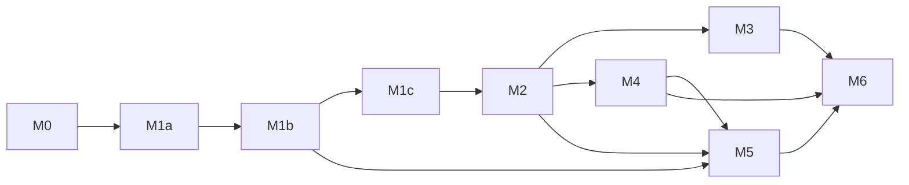

# Roadmap и условия выпуска

Структура и границы релизов утверждены. M0 принят с ограничениями 22 ноября 2026 года. Реализация B/C проверена, открытые аппаратные и ручные критерии D/E перечислены в [отчёте M0](M0-RESULTS.md). Владелец согласовал реализацию M1a. Кратчайший путь к надёжному Raw — M0 → M1a → M1b. Полный исходный продукт включает также M1c. Действующий Smart остаётся доступным на переходных этапах. До M1c его надёжность не объявляется принятой.

| Этап и зависимости | Граница поставки | Условия приёмки |
|---|---|---|
| M0 · Baseline & Safety | Воспроизводимый снимок текущего приложения, немедленные меры безопасности, лёгкие регрессии, ограниченные эксперименты и исходные метрики. | Оба существующих пути проверены. В новых логах нет пользовательского текста, чужие LLM не выгружаются, внешняя сеть контролируется. Ограничения доставки и результаты экспериментов записаны. По каждой проверке baseline указан метод или причина отсутствия измерения. Детали по пакетам — в [backlog](BACKLOG.md). |
| M1a · Reliable Original, после M0 | Владелец SQLite, миграция JSON, commit Original, минимальные метаданные, ограниченные очередь/PCM, отмена и безопасный выход. Подключить существующий Smart к сохранённому Original. | После commit Original доступен при перезапуске, скрытом окне и отказе LLM. Повтор импорта идемпотентен, legacy Original неизвестен, старые файлы сохранены. Ошибка записи показана, доставка заблокирована. После рестарта нет автовставки. |
| M1b · Reliable Delivery, после M1a и экспериментов M0 | Матрица получателей, снимок и проверка цели, безопасный буфер, три действия доставки, независимые статусы. **Стабильная Raw-диктовка.** | В проверенном профиле один PTT-жест даёт доступный текст. Смена окна, поля, выделения или буфера оставляет артефакт без опасной вставки. После прерывания нет повторной отправки. Raw и существующий Smart продолжают работать. |
| M1c · Reliable Smart Dictation, после M1b | Первый стабильный продуктовый релиз с **Raw и Smart**. Сохранение Original до LM Studio, проверка структуры и завершённости, видимый fallback, commit результата до доставки. | При успешном ответе доступны обе версии. При пустом, null, усечённом, неверном ответе или недоступности LM Studio сохраняется Original, предыдущий успех остаётся. UI различает обработку, запись и доставку. Пройдены регрессии обеих первоначальных функций. |
| M2 · Smart Processing, после M1c | Встроенные и пользовательские пресеты, модель/timeout на пресет, валидируемый JSON, повторы, ручные правки и контроль ревизий. | Все семейства проходят свою проверку результата и fallback. Ошибка перевода не отправляет Raw по умолчанию. Поздний ответ не затирает правку. Импорт не выдаёт сетевых разрешений. |
| M3 · AI Engine & Performance, после M2 | Политики моделей, реальная диагностика, независимый benchmark Qwen, оценка очереди 1+1. Начальные механизмы отмены и shutdown уже существуют. | Есть сопоставимые качество, p50/p95 и ресурсы на целевой машине. Назначение модели по умолчанию обосновано. Performance/Economy вводятся только при измеримом поведении. Проверены OOM и отсутствие счётчика VRAM. |
| M4 · Workspace & Design System, после M2 | Панели и редактор, поиск FTS5, страницы истории, избранное, корзина и retention, экспорт, темы, Palette, локали, overlay. Может развиваться после M2 независимо от экспериментов M3. | Четыре локали, DPI и несколько мониторов проверены. Overlay не меняет фокус в матрице. Поиск и правки согласованы с БД, корзина скрыта, дефолт 30 дней, срок изменяем. Большая история не блокирует диктовку. |
| M5 · Windows Input Workspace, после M1b, M2 и командного UI M4 | Четыре источника, безопасная замена/предпросмотр, ручные профили с автоактивацией, Toggle, назначаемые hotkeys и проверка конфликтов. | Сценарии подтверждены по профилям. Неоднозначная цель, защищённое поле и недоступный буфер имеют безопасный исход. Не генерируются Enter/Send. Тот же цикл хранения используется всеми источниками. |
| M6 · Product Release 1.0, после M3, M4, M5 | Папка с EXE/runtime, диагностика зависимостей, поставка, совместимость данных и приёмка на чистой Windows. | Без системного Python и сети с локальными весами работает Raw. С локальной LM Studio работает Smart. Отсутствие LLM не блокирует Raw. Пройдены проверки миграции, обновления совместимых данных и отката. |

## Переходы и откат

- В M0 вводятся немедленные меры защиты и проверки отказов. К M1a ограничение аудио, отмена и закрытие ресурсов имеют владельца и проверяются при перезапуске. M1b добавляет точную границу отмены перед отправкой. M1c проверяет поздний ответ LLM.
- Переходный UI сохраняет доступ к обоим режимам. При риске временного отключения Smart описать затронутый сценарий, альтернативу, срок и условие восстановления и запросить отдельное разрешение владельца.
- Откат отдельной функции сохраняет артефакты и использует совместимый reader. При неопределённой доставке остаются видимый результат и ручной Copy. Проверки и риски привязаны к milestones в [TESTING](TESTING.md) и [RISKS](RISKS.md).
